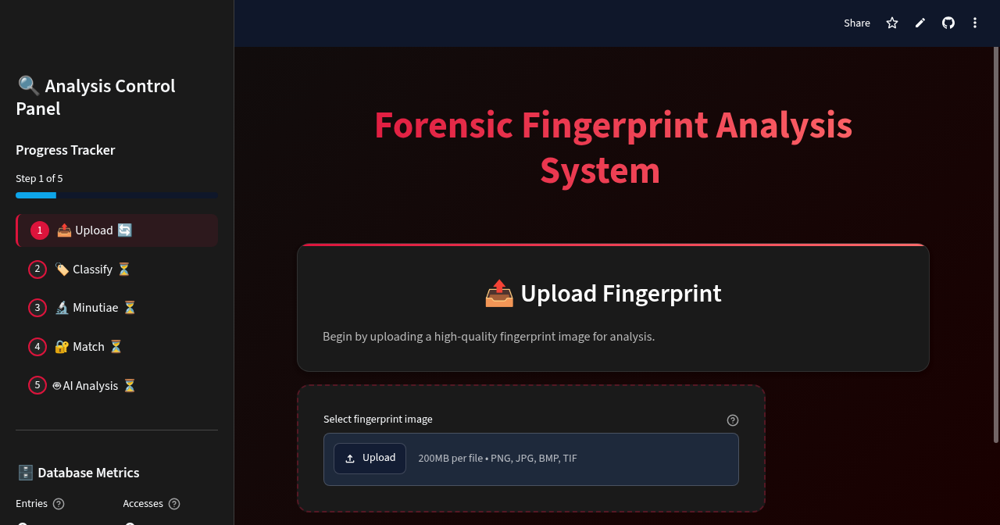

# Fingerprint Pattern Analysis System

A Streamlit app that classifies a fingerprint image as **arch, loop or whorl** using OpenCV image processing and a scikit-learn classifier. It also contains experimental minutiae-detection, matching and AI-assistant modules.

**Live demo (free Streamlit hosting, may need a click to wake up):** https://fingerprint-identification.streamlit.app/



*Real screenshot of the live app.*

## About this project

This started as a university team project (the "M.A.H.E" group). The team did not contribute code, so I built and maintain it on my own. The `archive/` folder keeps earlier per-module workspaces from that period.

## What it does and does not do

- **Works and is demoed:** upload a fingerprint image, classify it as arch, loop or whorl, step through the 4-step workflow (Upload, Classify, Minutiae, Match).
- **Experimental, not evaluated here:** minutiae detection, database matching, spoof/liveness checks and the optional OpenAI-based explanations. No accuracy numbers are claimed for them.
- **No published accuracy figure for the classifier yet.** Only a measured number on a held-out set would be honest here, and it has not been run. Treat it as a demo.
- Educational/research software, not production biometrics.

## Setup

1. **Clone the repo**
   ```bash
   git clone https://github.com/Dolphiny-1412/fingerprint-identification.git
   cd fingerprint-identification
   ```

2. **Install dependencies** (minimal, fast):
   ```bash
   pip install -r requirements-minimal.txt
   ```
   Or full install (includes TF/PyTorch for experimental modules):
   ```bash
   pip install -r requirements.txt
   ```

3. **Configure environment** (optional — needed only for OpenAI AI explanations):
   ```bash
   cp .env.example .env
   # Edit .env and add your OPENAI_API_KEY
   ```

4. **Train the classifier** (required for classification to work):
   ```bash
   # Place labeled images in: data/Loop/, data/Whorl/, data/Arch/
   python -c "from src.core.classifier import train_classifier; train_classifier('data')"
   ```

5. **Run the app**:
   ```bash
   streamlit run src/ui/app_modern.py
   # Or: python main.py
   # Or on Windows: double-click run_app.bat
   ```

## 🏗️ Project Structure

```
src/
├── core/           # Core fingerprint analysis modules
│   ├── classifier.py
│   ├── minutiae_detector.py
│   ├── fingerprint_matcher.py
│   └── ai_assistant.py
├── ui/             # User interface components
│   ├── app.py
│   ├── app_modern.py
│   └── design_system.py
├── utils/          # Utility functions and helpers
├── models/         # Machine learning models and training scripts
├── data/           # Data storage and management
├── config/         # Configuration files
├── tests/          # Test suite
└── docs/           # Documentation
docs/             # Research paper (IEEE format) and conference template
assets/samples/   # Sample fingerprint images used by module self-tests
archive/          # Original per-member development workspaces (code only)
```

## Tests

```bash
python -m pytest src/tests/
```

## Documentation

- `src/docs/README.md` and `src/docs/SYSTEM_COMPLETION_SUMMARY.md`: development notes
- `docs/`: the course research paper (IEEE format) and the conference template

## License

MIT, see `LICENSE`.
